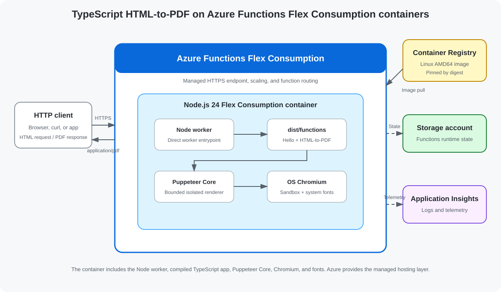

<!--
---
name: TypeScript HTML-to-PDF on Azure Functions Flex Consumption containers
description: >-
  This sample contains an Azure Functions Flex Consumption container
  application written in TypeScript for Node.js 24. It accepts bounded HTML
  and returns a PDF rendered with Puppeteer Core and OS-installed Chromium.
page_type: sample
languages:
- typescript
- bicep
- azdeveloper
- dockerfile
products:
- azure
- azure-functions
- azure-container-registry
urlFragment: flex-container-node-html-to-pdf
---
-->

# TypeScript HTML-to-PDF on Azure Functions Flex Consumption containers

This sample accepts self-contained HTML in an HTTP POST request and returns a
PDF rendered with Puppeteer Core and the operating system's Chromium package.
It also provides a GET endpoint that returns a built-in invoice PDF.

The Azure Functions app runs from a Node.js 24 Flex Consumption container.
Azure Developer CLI (`azd`) provisions the Azure resources, builds the
container with Azure Container Registry Tasks, deploys it by immutable digest,
and verifies the live endpoints.



> [!IMPORTANT]
> Azure Functions Flex Consumption container support is currently in preview.
> Preview capabilities and deployment requirements may change before general
> availability.

## Sample workflow

1. Clone the repository.
1. Run `azd up` to build and deploy the Node.js 24 container.
1. GET the built-in invoice or POST your HTML to `/api/html-to-pdf`.
1. Save or display the returned `application/pdf` response.

You may use `func start` to verify the function code locally. During the
preview, deploy to Azure for end-to-end container validation.

## Prerequisites

- [Git](https://git-scm.com/downloads)
- [Node.js 24](https://nodejs.org/)
- [Azure CLI](https://learn.microsoft.com/cli/azure/install-azure-cli)
- [Azure Developer CLI](https://learn.microsoft.com/azure/developer/azure-developer-cli/install-azd)
- an Azure subscription enabled for the Registry-backed Flex Consumption
  container preview
- permission to create resource groups, storage, monitoring, Azure Container
  Registry, FC1 plans, and Function Apps

Local Docker isn't required for the `azd` deployment.

## Initialize the project

```shell
git clone https://github.com/MadhuraBharadwaj-MSFT/flex-container-node-html-to-pdf.git
cd flex-container-node-html-to-pdf
```

## How it works

The TypeScript app exposes two HTTP functions:

| Method | Route | Behavior |
|---|---|---|
| GET / POST | `/api/hello` | Returns `Hello from the BYOC Node.js worker.` |
| GET | `/api/html-to-pdf` | Returns a built-in invoice PDF |
| POST | `/api/html-to-pdf` | Converts bounded UTF-8 `text/html` to PDF |

For HTML-to-PDF requests, the app:

1. validates the media type, UTF-8 body, and 256 KiB input limit;
1. sanitizes the optional `X-Pdf-Filename` response filename;
1. launches OS-installed Chromium with Puppeteer Core as a non-root user;
1. disables JavaScript, enables offline mode, and blocks external subresources;
1. enforces one concurrent render, a 20-second render timeout, and a 5 MiB
   output limit;
1. validates cleanup of browser and page resources;
1. returns `application/pdf` with no-store and nosniff headers.

Exact runtime and dependency pins live in
[`node24.Dockerfile`](./node24.Dockerfile),
[`package.json`](./package.json), and
[`package-lock.json`](./package-lock.json). Those files are the source of truth
for version updates.

The TypeScript compiler emits function entrypoints to `dist/functions`. The
multi-stage image copies only compiled JavaScript, production dependencies,
the standalone Node worker, Chromium, and fonts into the runtime image.

## How the container image is built

The deployment uses
[Azure Container Registry Tasks](https://learn.microsoft.com/azure/container-registry/container-registry-tasks-overview)
to build the Linux AMD64 image in Azure. Customers don't need local Docker to
deploy the sample.

During `azd up`:

1. [`imagecontext.mjs`](./infra/scripts/imagecontext.mjs) stages only files
   that affect the image and calculates a deterministic SHA-256.
1. The hash becomes the image tag: `azd-<context-hash>`.
1. An existing tag is reused; otherwise `az acr build` runs the ACR Tasks
   quick build.
1. The workflow resolves the registry manifest digest.
1. The Function App is pinned to
   `registry/repository:tag@sha256:digest`.
1. The tag is write- and delete-locked so its digest can't move.

The Node worker archive is also SHA-256 verified during the image build.

## Deploy to Azure

Sign in:

```shell
az login
azd auth login
```

Create an `azd` environment and set the required deployment locations:

```shell
azd env new node-pdf-flex --no-prompt
azd env set AZURE_SUBSCRIPTION_ID <subscription-id>
azd env set AZURE_LOCATION eastus2
azd env set AZURE_FUNCTION_LOCATION eastus2euap
```

`AZURE_LOCATION` is used for storage, ACR, Log Analytics, and Application
Insights. `AZURE_FUNCTION_LOCATION` is used for the FC1 plan and Function App.
The split is required because Log Analytics isn't available in
`eastus2euap`.

Provision the resources, build the container, deploy it, and verify the Hello
and PDF endpoints:

```shell
azd up
```

For unattended execution, use `azd up --no-prompt` after all four environment
values are set.

The deployment creates the Function App directly with:

```text
functionAppConfig.deployment.storage.type = Registry
```

It doesn't create a code-deployed Function App and convert it afterward.

## Test the deployed container

Get the deployed endpoint.

PowerShell:

```powershell
$apiUrl = azd env get-value API_URL
```

Bash:

```bash
API_URL=$(azd env get-value API_URL)
```

Verify the Hello endpoint:

PowerShell:

```powershell
curl.exe --fail --show-error "$apiUrl/api/hello"
```

Bash:

```bash
curl --fail --show-error "$API_URL/api/hello"
```

POST the included [`sample.html`](./sample.html).

PowerShell:

```powershell
curl.exe --fail --show-error `
  --request POST `
  --header "Content-Type: text/html; charset=utf-8" `
  --header "X-Pdf-Filename: node-flex-sample.pdf" `
  --data-binary "@sample.html" `
  --output document.pdf `
  --write-out "HTTP %{http_code}; Content-Type %{content_type}; Bytes %{size_download}`n" `
  "$apiUrl/api/html-to-pdf"
```

Bash:

```bash
curl --fail --show-error \
  --request POST \
  --header 'Content-Type: text/html; charset=utf-8' \
  --header 'X-Pdf-Filename: node-flex-sample.pdf' \
  --data-binary @sample.html \
  --output document.pdf \
  --write-out $'HTTP %{http_code}; Content-Type %{content_type}; Bytes %{size_download}\n' \
  "$API_URL/api/html-to-pdf"
```

Expected output resembles:

```text
HTTP 200; Content-Type application/pdf; Bytes 20000
```

The byte count varies but must be greater than zero. Verify the PDF boundaries:

```shell
node -e "const fs=require('node:fs');const b=fs.readFileSync('document.pdf');if(b.subarray(0,5).toString('ascii')!=='%PDF-'||!/%%EOF\\s*$/.test(b.subarray(-128).toString('ascii')))throw new Error('Invalid PDF');console.log('Valid PDF: '+b.length+' bytes')"
```

Expected output:

```text
Valid PDF: <non-zero byte count> bytes
```

Open the generated PDF.

Windows:

```powershell
Start-Process .\document.pdf
```

macOS:

```bash
open document.pdf
```

Linux:

```bash
xdg-open document.pdf
```

The displayed PDF should contain:

- **Azure Functions HTML-to-PDF**
- **Rendered with Puppeteer Core and system Chromium**
- **This document is self-contained and doesn't load external resources.**

You can also download the built-in invoice:

```shell
curl --fail --show-error "$API_URL/api/html-to-pdf" --output invoice.pdf
```

## Redeploy container changes

This section isn't needed for the initial deployment. Use it later if you
change the TypeScript source, Node dependencies, vendored compiler packages,
or Dockerfile and want to deploy an updated container.

Rerun `azd up`, or use the image-only workflow after the environment is
provisioned:

PowerShell:

```powershell
.\infra\scripts\deployimage.ps1 -Verify
```

Bash:

```bash
sh ./infra/scripts/deployimage.sh --verify
```

Unchanged image inputs reuse the existing digest.

## Security

Rendering untrusted HTML invokes a complex browser parser. Before production
use, add authentication, authorization, rate limiting, tenant isolation, abuse
monitoring, and workload-specific HTML sanitization.

This sample:

- uses anonymous HTTP triggers only to simplify the sample;
- keeps ACR admin and anonymous pull disabled;
- grants the Function App a repository-scoped read-only pull credential;
- passes registry and storage secrets only as secure deployment parameters;
- doesn't write those secrets to source or `azd` environment outputs;
- runs the application and Chromium as the non-root `node` user;
- keeps Chromium's sandbox enabled;
- disables JavaScript and external subresources;
- doesn't accept arbitrary URLs for server-side fetching;
- bounds input, output, concurrency, and execution time.

## Preview limitations

- The direct Registry deployment uses preview Azure resource APIs.
- Region and subscription enablement are required.
- Storage and ACR use public service endpoints in this sample.
- Runtime storage currently uses a connection string passed as a secure
  deployment parameter.
- The HTTP endpoints are anonymous.
- The image is Linux AMD64 only.

## Costs

The environment can incur charges for:

- Flex Consumption executions;
- Azure Container Registry storage and ACR Tasks builds;
- the storage account;
- Log Analytics and Application Insights ingestion;
- Chromium CPU time and cold starts.

## Clean up resources

Review the selected environment:

```shell
azd env get-values
```

Delete the resource group and all resources created for that environment:

```shell
azd down --force
```

This command doesn't delete the local repository.

## Resources

- [Azure Developer CLI](https://learn.microsoft.com/azure/developer/azure-developer-cli/)
- [Run Azure Functions locally](https://learn.microsoft.com/azure/azure-functions/functions-run-local)
- [Azure Functions Flex Consumption](https://learn.microsoft.com/azure/azure-functions/flex-consumption-plan)
- [Azure Functions Node.js developer guide](https://learn.microsoft.com/azure/azure-functions/functions-reference-node)
- [Azure Container Registry Tasks](https://learn.microsoft.com/azure/container-registry/container-registry-tasks-overview)
- [Puppeteer](https://pptr.dev/)

## License

This sample is licensed under the [MIT License](LICENSE).
