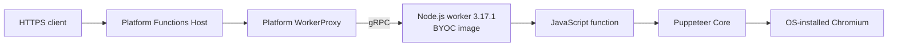

# HTML to PDF on Azure Functions Flex Consumption BYOC (Node.js)

This sample packages a Node.js 24 Azure Functions language worker, a JavaScript
HTTP function, Puppeteer Core, and OS-installed Chromium in a Linux AMD64
container. It demonstrates the limited-preview Flex Consumption
bring-your-own-container (BYOC) worker model.

> [!IMPORTANT]
> This is prototype guidance for a limited preview, not a production support
> policy. Preview access, regions, APIs, and deployment behavior can change.
> The anonymous HTTP endpoint is only for a simple demo; require authentication
> and abuse controls before using this pattern outside an isolated evaluation.

## What the sample does

- `GET /api/html-to-pdf` renders a polished, self-contained sample invoice.
- `POST /api/html-to-pdf` accepts a raw `text/html` body and renders it.
- Successful responses use `application/pdf` and a fixed, safe attachment name.
- Empty, non-HTML, and larger-than-512-KiB requests receive explicit 4xx errors.
- Chromium launch and PDF generation are bounded by timeouts.
- JavaScript and external subresource requests are disabled during rendering.
- Every request closes its Chromium page and browser.

The application uses `@azure/functions` **4.17.0**, which is the Node.js
programming-model package used by the function code. The image separately
contains the official Azure Functions Node.js **language worker 3.17.1**.
Installing `@azure/functions` does not install or replace the language worker.

## Architecture



The platform runs Functions Host and WorkerProxy. The image runs only the
language worker and application. It does **not** package Functions Host,
WorkerProxy, or an HTTP server, and it does not expose a container port.
Publishing a port with `docker run -p` cannot turn the worker into a standalone
Function App.

At startup, the platform supplies the worker's canonical `--functions-uri`,
`--functions-worker-id`, `--functions-request-id`, and
`--functions-grpc-max-message-length` arguments. The image starts the worker
directly at `/opt/functions-worker/dist/src/nodejsWorker.js`, and the platform
sets the image-local application directory to `/home/site/wwwroot`.

No startup adapter, worker bundle patch, Host download, fixed gRPC port,
`FUNCTIONS_APPLICATION_DIRECTORY` override, or environment-reload workaround is
used by the current contract.

## Prerequisites

- A machine that can build Linux AMD64 images with Docker BuildKit.
- Node.js 24 and npm for source tests and lockfile maintenance.
- Azure Functions Core Tools v4 for optional local host testing.
- A locally installed Chromium, Chrome, or Edge executable for optional local
  rendering tests.
- Azure CLI and an authenticated Azure account.
- Access to the limited Flex Consumption BYOC preview in an enabled subscription
  and region. Do not assume every public region supports this flow.
- Permission to create or configure a Flex Consumption Function App and to push
  images and create repository-scoped tokens in a private Azure Container
  Registry (ACR).
- Existing or newly approved resource group, Functions storage, Application
  Insights, and private ACR resources.

Docker, Azure resources, image storage, telemetry, and HTTP requests can incur
charges.

## Repository layout

| Path | Purpose |
| --- | --- |
| `node24.Dockerfile` | Linux AMD64 worker-only image with Node.js 24, worker 3.17.1, Chromium, and fonts |
| `package.json` / `package-lock.json` | Pinned application dependencies |
| `host.json` | Application Host configuration for local development; see the preview limitation below |
| `src/functions/htmlToPdf.js` | Node.js v4 HTTP trigger registration |
| `src/html-to-pdf-handler.js` | HTTP validation, response headers, and error mapping |
| `src/pdf-renderer.js` | Puppeteer launch, network blocking, timeouts, PDF generation, and cleanup |
| `src/sample-invoice.js` | Self-contained GET invoice |
| `test/` | Focused request and renderer tests |
| `.dockerignore` | Allowlisted, credential-free image build context |

## Test the source locally

Install dependencies and run the focused tests with Node.js 24:

```powershell
npm ci
npm test
```

To run through a local Functions Host, copy the example settings and set
`CHROMIUM_PATH` to an installed browser:

```powershell
Copy-Item .\local.settings.example.json .\local.settings.json

# Example only; use the actual executable installed on your machine.
$settings = Get-Content .\local.settings.json -Raw | ConvertFrom-Json
$settings.Values.CHROMIUM_PATH = 'C:\Program Files\Google\Chrome\Application\chrome.exe'
$settings | ConvertTo-Json -Depth 10 | Set-Content .\local.settings.json

func start
```

In another terminal:

```powershell
Invoke-WebRequest `
  -Uri 'http://localhost:7071/api/html-to-pdf' `
  -OutFile .\sample-invoice.pdf

@'
<!doctype html>
<html>
  <head>
    <meta charset="utf-8">
    <style>body { font: 20px Arial; padding: 48px; color: #172033; }</style>
  </head>
  <body><h1>Customer HTML</h1><p>Rendered locally.</p></body>
</html>
'@ | Set-Content .\custom.html

Invoke-WebRequest `
  -Uri 'http://localhost:7071/api/html-to-pdf' `
  -Method Post `
  -ContentType 'text/html; charset=utf-8' `
  -InFile .\custom.html `
  -OutFile .\custom.pdf
```

This local Host test validates the application and rendering code. It does not
validate the preview platform's Host/WorkerProxy handshake. Conversely, the
worker-only container cannot be tested by sending HTTP directly to it; the
platform must supply its gRPC startup arguments and application directory.

## Build the Linux AMD64 image

The Dockerfile downloads the standalone worker archive from the official
worker 3.17.1 release and verifies this SHA-256 during the build:

```text
424407adbde0d2ad922cb1116bb4e70de551c6744e3d01ec72542633f5db33c2
```

Build from the repository root:

```powershell
$localImage = 'html-to-pdf-byoc:3.17.1-node24'

docker build `
  --platform linux/amd64 `
  --file .\node24.Dockerfile `
  --tag $localImage `
  .
```

`puppeteer-core` is used intentionally: it does not download a second browser.
Chromium and useful Latin, CJK, and emoji fonts are installed as OS packages.
The final image runs as the non-root `node` user.

The Dockerfile defaults to the public npm registry. To use another approved
public mirror, regenerate `package-lock.json` against that same registry and
pass it explicitly:

```powershell
docker build `
  --platform linux/amd64 `
  --build-arg NPM_REGISTRY='https://<approved-public-npm-registry>/' `
  --file .\node24.Dockerfile `
  --tag $localImage `
  .
```

If that registry requires authentication, mount an npm configuration as a
BuildKit secret instead of copying it or passing credentials as build
arguments:

```powershell
docker build `
  --platform linux/amd64 `
  --build-arg NPM_REGISTRY='https://<approved-npm-registry>/' `
  --secret 'id=npmrc,src=<absolute-path-to-temporary-npmrc>' `
  --file .\node24.Dockerfile `
  --tag $localImage `
  .
```

The secret is available only to the dependency installation step and is not
stored in an image layer. Do not copy credentials into the build context or
disable TLS verification.

## Push to ACR and pin the manifest digest

Use placeholders rather than reusing shared production names:

```powershell
$ErrorActionPreference = 'Stop'
$PSNativeCommandUseErrorActionPreference = $true

$registry = '<private-acr-name>'
$repository = 'html-to-pdf-byoc'
$tag = "worker-3.17.1-node24-$([DateTime]::UtcNow.ToString('yyyyMMdd-HHmmss'))"

$registryServer = az acr show `
  --name $registry `
  --query loginServer `
  --output tsv
$imageName = "${registryServer}/${repository}:${tag}"

az acr login --name $registry
docker tag $localImage $imageName
docker push $imageName

$digest = az acr repository show `
  --name $registry `
  --image "${repository}:${tag}" `
  --query digest `
  --output tsv

if ($digest -notmatch '^sha256:[0-9a-f]{64}$') {
  throw 'ACR did not return a valid image digest.'
}

$pinnedImage = "${imageName}@${digest}"
$pinnedImage
```

Use the registry manifest or index digest returned by ACR, not a local Docker
image configuration ID. Keep ACR admin credentials and anonymous pulls
disabled.

## Convert an ordinary Flex app to preview BYOC

The current preview flow starts with a **new ordinary Node.js 24 Flex
Consumption Function App** created through the enabled portal or your approved
Flex provisioning process:

| Setting | Required selection |
| --- | --- |
| Hosting | Flex Consumption / FC1 |
| OS | Linux |
| Language | Node.js 24 |
| Region | North Central US, with BYOC preview access enabled for the subscription |
| Storage | Valid Functions storage configuration |
| Monitoring | Application Insights |

Do not use the classic App Service custom-container or `linuxFxVersion` path.
The current preview conversion uses the Microsoft.Web control-plane API and
Basic ACR authentication. Do not assume managed-identity image pulls are
supported by this prototype.

Set deployment variables:

```powershell
$subscription = '<subscription-id>'
$resourceGroup = '<function-app-resource-group>'
$appName = '<new-function-app-name>'

$credentialSuffix = [DateTime]::UtcNow.ToString('yyyyMMdd-HHmmss')
$pullToken = "pdf-$credentialSuffix"
$scopeMap = "$pullToken-read"

az account set --subscription $subscription

$siteId = "/subscriptions/$subscription/resourceGroups/$resourceGroup/providers/Microsoft.Web/sites/$appName"
$siteBase = "https://management.azure.com${siteId}"
$api = '2026-08-01'
```

Create a new repository-read-only ACR token and scope map. Do not reuse a shared
token or scope map:

```powershell
az acr scope-map create `
  --registry $registry `
  --name $scopeMap `
  --repository $repository content/read metadata/read `
  --output none

az acr token create `
  --registry $registry `
  --name $pullToken `
  --scope-map $scopeMap `
  --no-passwords `
  --output none
```

The following block keeps credentials in memory, refuses to overwrite existing
credential settings, merges current app settings, and preserves the app's plan,
scaling, and other `functionAppConfig` fields. Avoid concurrent configuration
changes while it runs:

```powershell
$accessToken = az account get-access-token `
  --subscription $subscription `
  --resource 'https://management.azure.com/' `
  --query accessToken `
  --output tsv
$headers = @{ Authorization = "Bearer $accessToken" }

try {
  $site = Invoke-RestMethod `
    -Method Get `
    -Uri "${siteBase}?api-version=$api" `
    -Headers $headers

  $config = $site.properties.functionAppConfig
  if ($config.runtime.name -ne 'node' -or $config.runtime.version -ne '24') {
    throw 'Expected an ordinary Node.js 24 Flex Consumption app.'
  }

  $settingsBase = "${siteBase}/config/appsettings"
  $settings = Invoke-RestMethod `
    -Method Post `
    -Uri "${settingsBase}/list?api-version=$api" `
    -Headers $headers

  foreach ($name in 'BYOC_REGISTRY_USERNAME', 'BYOC_REGISTRY_PASSWORD') {
    if ($settings.properties.PSObject.Properties.Name -contains $name) {
      throw "Setting $name already exists; refusing to overwrite it."
    }
  }

  $credentialsJson = az acr token credential generate `
    --registry $registry `
    --name $pullToken `
    --password1 `
    --expiration-in-days 7 `
    --output json
  $credentials = $credentialsJson | ConvertFrom-Json
  $password = $credentials.passwords |
    Where-Object name -eq 'password1' |
    Select-Object -First 1

  if (-not $credentials.username -or -not $password.value -or -not $password.expiry) {
    throw 'The generated pull credential is incomplete.'
  }

  $settings.properties | Add-Member `
    -NotePropertyName BYOC_REGISTRY_USERNAME `
    -NotePropertyValue $credentials.username
  $settings.properties | Add-Member `
    -NotePropertyName BYOC_REGISTRY_PASSWORD `
    -NotePropertyValue $password.value

  $settingsBody = @{ properties = $settings.properties } |
    ConvertTo-Json -Depth 20
  $null = Invoke-RestMethod `
    -Method Put `
    -Uri "${settingsBase}?api-version=$api" `
    -Headers $headers `
    -ContentType 'application/json' `
    -Body ([Text.Encoding]::UTF8.GetBytes($settingsBody))

  $config.runtime = $null
  $config.deployment.storage = @{
    type = 'Registry'
    value = $pinnedImage
    authentication = @{
      type = 'Basic'
      usernameSettingName = 'BYOC_REGISTRY_USERNAME'
      passwordSettingName = 'BYOC_REGISTRY_PASSWORD'
    }
  }

  $body = @{ properties = @{ functionAppConfig = $config } } |
    ConvertTo-Json -Depth 20
  $null = Invoke-RestMethod `
    -Method Patch `
    -Uri "${siteBase}?api-version=$api" `
    -Headers $headers `
    -ContentType 'application/json' `
    -Body ([Text.Encoding]::UTF8.GetBytes($body))

  Write-Host "Renew the pull credential before $($password.expiry)."
}
finally {
  $accessToken = $headers = $credentialsJson = $credentials = $password = $null
  $settings = $settingsBody = $body = $null
}
```

The ACR username and password are application-readable secret settings in this
preview flow. Do not print them, enable debug tracing around the script, export
app settings, or write them to a file. Renew the seven-day credential and
update the settings **before it expires** or a later image pull can fail.

For a later release, push a unique tag, resolve its digest, then merge only the
new `deployment.storage.value` into the app's current `functionAppConfig`.
Never replace the whole site configuration with a stale local copy.

## Invoke and verify the PDFs

Use the hostname returned by the site resource; regional suffixes vary:

```powershell
$baseUri = "https://$($site.properties.defaultHostName)/api/html-to-pdf"

Invoke-WebRequest `
  -Uri $baseUri `
  -TimeoutSec 60 `
  -OutFile .\sample-invoice.pdf

Invoke-WebRequest `
  -Uri $baseUri `
  -Method Post `
  -ContentType 'text/html; charset=utf-8' `
  -InFile .\custom.html `
  -TimeoutSec 60 `
  -OutFile .\custom.pdf
```

Verify that each response is a non-empty PDF rather than trusting only the
Function App's control-plane `Running` state:

```powershell
foreach ($path in '.\sample-invoice.pdf', '.\custom.pdf') {
  $bytes = [IO.File]::ReadAllBytes($path)
  $signature = [Text.Encoding]::ASCII.GetString($bytes, 0, [Math]::Min(5, $bytes.Length))
  if ($bytes.Length -lt 1000 -or $signature -ne '%PDF-') {
    throw "$path is not a valid non-empty PDF response."
  }

  Get-Item $path | Select-Object Name, Length
}
```

If startup initially times out, retry only within a bounded startup window.
Then inspect image-pull and Application Insights startup/indexing diagnostics
instead of retrying indefinitely.

## Security

Rendering attacker-controlled HTML is high risk. This sample reduces, but does
not eliminate, that risk:

- The demo endpoint is anonymous only to simplify evaluation.
- POST accepts only `text/html`, rejects empty bodies, and limits UTF-8 input to
  512 KiB.
- The renderer disables page JavaScript.
- Chromium requests are limited to `about:blank`, `data:`, and `blob:` URLs;
  external HTTP, file, and metadata-service requests are blocked.
- Browser launch, page loading, PDF generation, and cleanup are time-bounded.
- Each request receives a fresh browser that is closed afterward.
- The response filename is fixed and never derived from user input.
- The container runs as non-root and carries no registry or Azure credentials.

These controls are not a complete sandbox. HTML and CSS still exercise a large,
native browser parser, and this Dockerfile uses Chromium's `--no-sandbox`
container flag. For production design work, add platform authentication,
authorization, request throttling, concurrency limits, stricter input
sanitization, network isolation, image patching, monitoring, and an isolated
rendering boundary sized for hostile workloads. Do not add an endpoint that
fetches arbitrary URLs.

## Troubleshooting

| Symptom | Checks |
| --- | --- |
| Image pull fails | Confirm the exact `tag@sha256:digest`, repository-scoped permissions, credential setting names, token expiry, and registry network access. Do not enable ACR admin or anonymous pull as a shortcut. |
| Worker exits or no function appears | Confirm all four platform-supplied worker arguments, `/home/site/wwwroot`, `package.json` `main`, and the direct worker entrypoint. Do not restore an adapter or bundle patch. |
| Host rejects missing-language metadata | Use worker 3.17.1, which supplies the indexed function language metadata. Do not substitute an app setting workaround. |
| Worker archive checksum fails | Confirm version 3.17.1, the exact official release asset URL, and the SHA-256 shown above. Never bypass checksum verification. |
| Chromium executable is missing | In the image, confirm `CHROMIUM_PATH=/usr/bin/chromium` and that the `chromium` package installed. Locally, point `CHROMIUM_PATH` to your installed executable. |
| Chromium launch fails | Confirm the final image runs as `node`, `/tmp` is writable, enough memory is available, and container security policy permits the documented launch flags. |
| Rendering returns 500 or times out | Inspect Application Insights errors, simplify expensive HTML/CSS, and check memory pressure. External assets and JavaScript are intentionally blocked. |
| POST returns 413 | Keep the UTF-8 HTML body at or below 512 KiB. Large embedded data URLs count toward the limit. |
| Fonts render incorrectly | Confirm the required script is covered by the installed Noto/Liberation packages or add a reviewed OS font package. Do not fetch a font from user HTML. |
| `host.json` behavior differs in preview | Forwarding image-local `host.json` through the current BYOC platform remains pending; do not rely on custom Host settings for this prototype. |

## Costs and cleanup

This sample can create charges for Flex Consumption execution, storage,
Application Insights ingestion, ACR storage and operations, and network egress.
Review current pricing and set budgets before testing.

When finished, remove only resources created for this evaluation:

```powershell
az functionapp delete `
  --resource-group $resourceGroup `
  --name $appName

az acr token delete `
  --registry $registry `
  --name $pullToken `
  --yes

az acr scope-map delete `
  --registry $registry `
  --name $scopeMap `
  --yes

# Delete this repository/image only when no other deployment uses the digest.
az acr repository delete `
  --name $registry `
  --image "${repository}@${digest}" `
  --yes
```

If the Function App lives in a dedicated disposable resource group, deleting
that resource group can be simpler. Do not delete shared storage, monitoring,
or registry resources without confirming their other consumers.

## Current verification boundary

The worker 3.17.1 archive is stable and checksum-pinned. Its manifest declares
`dist/src/nodejsWorker.js` as the entrypoint. The supplied worker-only contract
has been validated locally on Linux AMD64 with Node.js 24, including non-root
startup and real worker gRPC indexing/invocation tests.

This repository is intentionally not deployed by its validation workflow.
Building the image and running the included source tests therefore do not prove
that a particular subscription, region, Host version, or preview control-plane
configuration is currently enabled.

## License

This project is licensed under the [MIT License](LICENSE).
